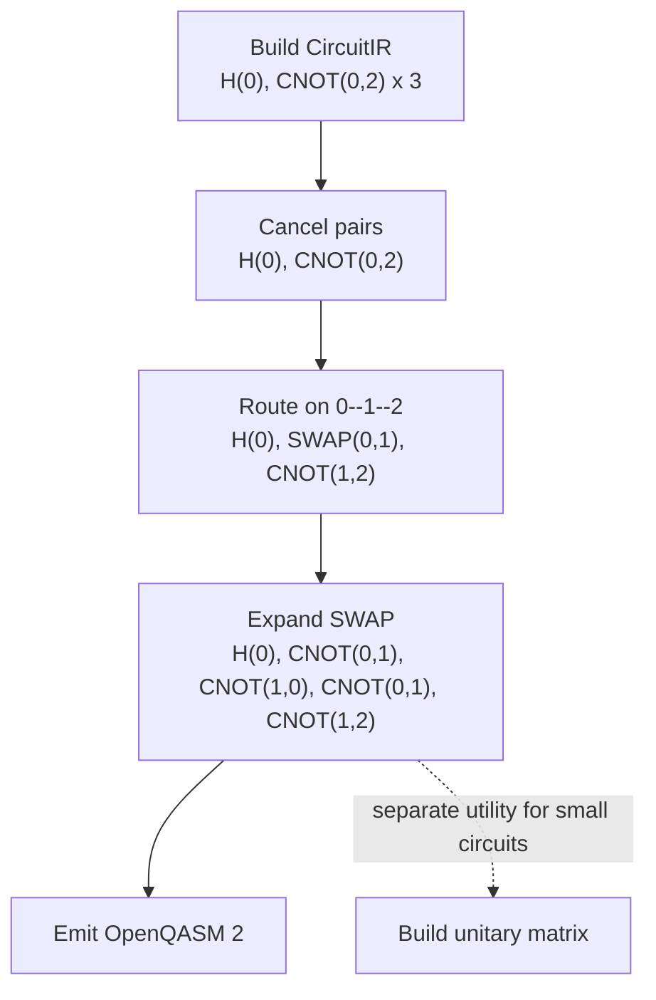

# Architecture and Worked Example

This page follows the example in `python -m quantum_compiler` from the circuit
the user builds to the OpenQASM text the program prints.



In the notation below, `H(0)` means an H gate on qubit 0, and `CNOT(0,2)`
means control qubit 0 and target qubit 2. At first, these indices are logical
qubits; after routing, gate indices refer to physical qubits.

## 1. Build the intermediate representation

`Gate` stores a gate name, the qubits it acts on, and optional parameters.
`CircuitIR` stores the number of qubits and an ordered list of gates. The
`add` method appends a gate and returns the circuit so calls can be chained.

The CLI constructs three logical qubits and this operation list:

```text
H(0)
CNOT(0,2)
CNOT(0,2)
CNOT(0,2)
```

It also describes the hardware as a line:

```text
physical 0 -- physical 1 -- physical 2
```

That means physical qubits 0 and 2 cannot interact directly; each can only
interact with its neighbor.

## 2. Cancel identical self-inverse gates

`cancel_adjacent_inverses` scans for two identical self-inverse gates with no
intervening operation touching either gate's qubits. The two CNOTs in the
middle of this example are identical and adjacent, so they cancel each other:

```text
Before: H(0), CNOT(0,2), CNOT(0,2), CNOT(0,2)
                         \________/
                          removed
After:  H(0), CNOT(0,2)
```

The remaining CNOT still acts on logical qubits 0 and 2. This pass only removes
operations; it does not route gates or change qubit indices.

## 3. Route logical gates onto the hardware

Routing starts with the default mapping:

| Logical qubit | Physical qubit |
| --- | --- |
| 0 | 0 |
| 1 | 1 |
| 2 | 2 |

`H(0)` needs just one qubit, so it remains on physical qubit 0. For `CNOT(0,2)`,
the router finds the shortest path `0 -> 1 -> 2`. The endpoints are not
neighbors, so it inserts `SWAP(0,1)` to move logical qubit 0 next to logical
qubit 2, then applies the CNOT:

```text
Routed physical operations:
H(0)
SWAP(0,1)     # bring logical qubit 0 from physical 0 to physical 1
CNOT(1,2)     # logical qubits 0 and 2 now occupy physical 1 and 2
```

The updated logical-to-physical mapping is `{0: 1, 1: 0, 2: 2}`. Routing
returns both the new circuit and this mapping, which callers can use to track
where each logical qubit ended up.

## 4. Lower SWAPs into CNOTs

The lowering pass replaces each SWAP with three CNOTs. This is a standard
decomposition that uses only a two-qubit gate supported by this example's
output:

```text
SWAP(0,1) -> CNOT(0,1), CNOT(1,0), CNOT(0,1)
```

So the full lowered sequence becomes:

```text
H(0)
CNOT(0,1)
CNOT(1,0)
CNOT(0,1)
CNOT(1,2)
```

The lowerer does not change the qubit count or the final layout.

## 5. Emit OpenQASM 2

`emit_qasm2` walks the lowered gates and writes the corresponding QASM
instructions. For this example the emitted text is:

```qasm
OPENQASM 2.0;
include "qelib1.inc";
qreg q[3];
h q[0];
cx q[0],q[1];
cx q[1],q[0];
cx q[0],q[1];
cx q[1],q[2];
```

In QASM, the router's physical qubit indices become wire indices in `q`.

## 6. Verify small circuits (separate utility)

`circuit_unitary` is a helper, not a stage called by the CLI. Given a circuit,
it constructs the full matrix describing its action on all basis states. For
example:

```python
from quantum_compiler import CircuitIR, circuit_unitary

unitary = circuit_unitary(CircuitIR(num_qubits=1).add("X", 0))
```

For this one-qubit X circuit, the result is:

```text
[[0, 1],
 [1, 0]]
```

The helper currently supports H, X, and CNOT gates and creates a matrix of
dimension `2**num_qubits` by `2**num_qubits`. That size grows exponentially,
so it is intended only for small circuits.

## Module responsibilities

| Module | What it contains | Example from this walkthrough |
| --- | --- | --- |
| `ir` | `Gate` and `CircuitIR` data models | Stores `CNOT(0,2)` as a named gate with qubits `(0, 2)` |
| `passes/cancellation` | Self-inverse gate cancellation | Removes the middle pair of CNOTs |
| `routing` | Coupling graph, shortest path, and layout updates | Inserts `SWAP(0,1)` and returns `{0: 1, 1: 0, 2: 2}` |
| `passes/lowering` | SWAP decomposition | Turns one SWAP into three CNOTs |
| `emission/qasm2` | OpenQASM 2 text generation | Writes `cx q[0],q[1];` for `CNOT(0,1)` |
| `verification` | Small-circuit unitary construction | Produces the 2x2 matrix for a one-qubit X gate |
