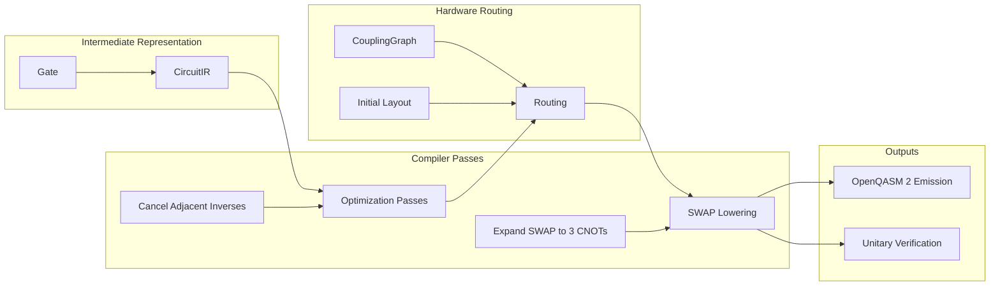

# Architecture and Data Flow

The compiler converts a circuit into the package's intermediate representation,
applies optimization and lowering passes, routes it onto the available hardware
topology, and emits or verifies the result.

## Module responsibilities

| Module | Responsibility |
| --- | --- |
| `ir` | Defines `Gate` and `CircuitIR`, including circuit construction helpers |
| `passes/cancellation` | Removes adjacent identical self-inverse gates |
| `passes/lowering` | Expands routed SWAP gates into CNOT sequences |
| `routing` | Finds physical paths and updates logical-to-physical mappings |
| `emission/qasm2` | Converts lowered circuits to OpenQASM 2 text |
| `verification` | Builds a full unitary matrix for small circuits |

## Package entry point

`quantum_compiler.__main__` creates an example circuit, runs cancellation and
routing, lowers SWAP operations, and prints the resulting OpenQASM output.
